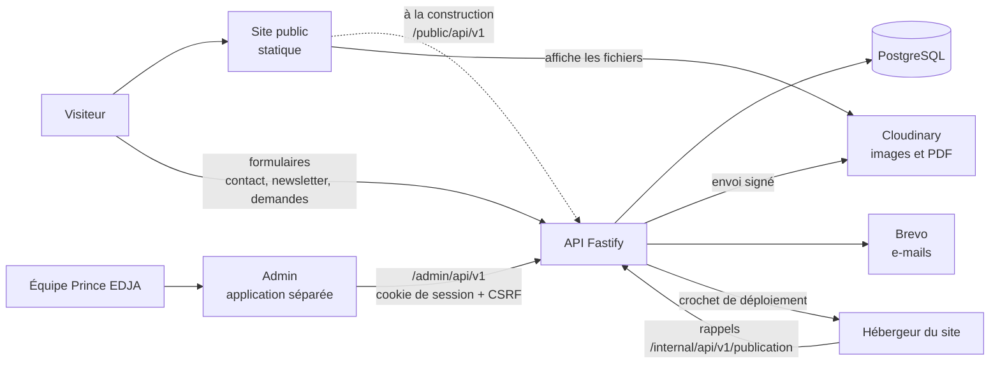
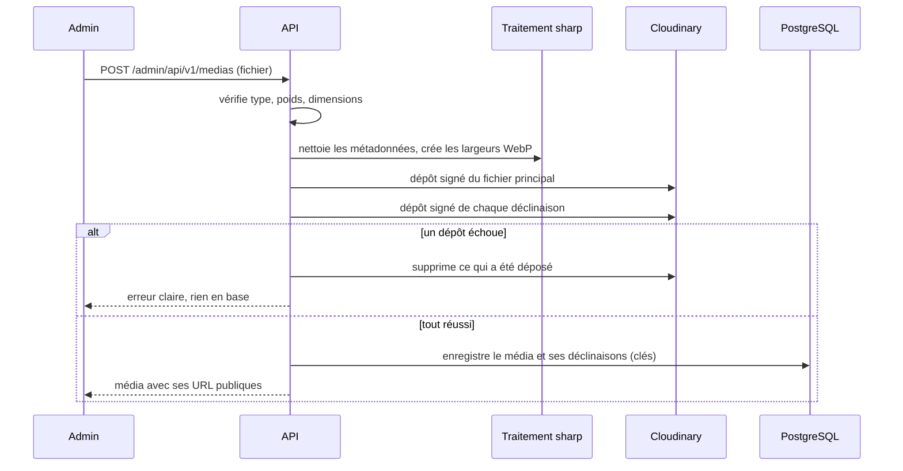
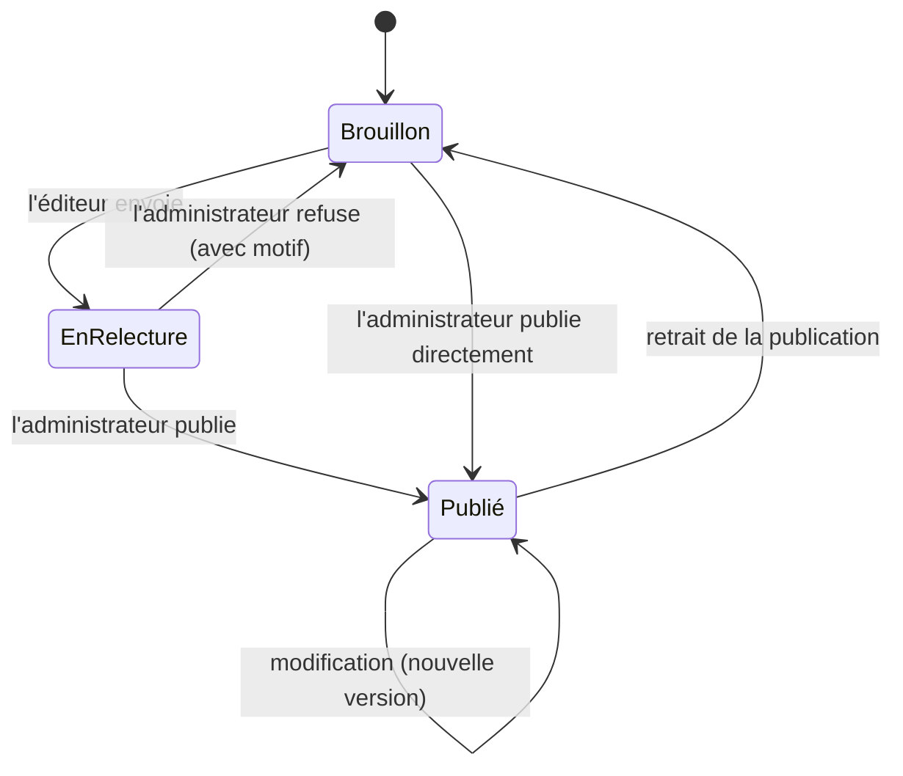
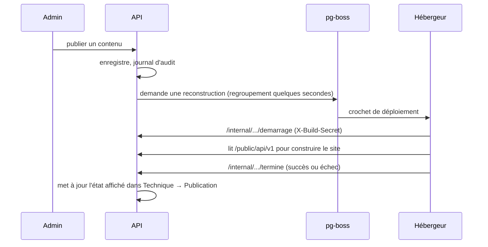

# Documentation guide — Système d'administration de Prince EDJA

Ce document explique **comment le système fonctionne et pourquoi**. Il accompagne `PROMPT-CORRECTION-PRINCE-EDJA.md` : le prompt dit **quoi changer**, cette documentation dit **comment tout s'articule**. En cas de doute, ce document décrit l'intention ; le code existant décrit l'état actuel ; en cas de désaccord entre les deux, tu le signales dans `docs/QUESTIONS.md` au lieu de choisir seul.

## Sommaire

1. Le projet en bref et vocabulaire
2. Architecture
3. Cloudinary : mise en place et fonctionnement
4. Rôles et droits
5. Carte de l'admin : entrée → route → ressource → table → module
6. Vie d'un contenu
7. Médias et photos du site
8. Publication du site
9. Multi-vendeurs
10. Formulaires publics, newsletter et données personnelles
11. Conventions de code et procédures
12. Variables d'environnement
13. Vérifier qu'une étape est vraiment terminée
14. Dépannage
15. Décisions prises et questions ouvertes

---

## 1. Le projet en bref et vocabulaire

**Le client** est Prince EDJA : entrepreneur, storyteller et producteur audiovisuel. Son site vitrine a trois volets : **Prince EDJA** (qui il est, ses collaborations, la presse), **EDJA Shop** (une boutique de bijoux, d'abord « sur demande », avec une vente en ligne possible plus tard) et **Projets et Histoires** (X'PLORE, documentaires, émissions, archives, destinations).

**Le site public** est un site statique : il est **reconstruit** quand le contenu change. L'administration sert à changer ce contenu sans toucher au code.

**L'utilisateur de l'admin** est rarement un technicien. Les écrans parlent donc un langage simple.

| Terme du système | Ce que ça veut dire | Mot affiché dans l'admin |
|---|---|---|
| contenu | un élément éditable : article, épisode, projet, destination, bijou… | article, bijou… |
| statut | l'état d'un contenu : `brouillon`, `en_relecture`, `publie` | Brouillon, En relecture, Publié |
| programmé | statut `publie` avec une date de publication future | Programmé |
| « à compléter » | un champ requis encore vide : **calculé**, ce n'est pas un statut | À compléter |
| slug | l'adresse d'une page (ex. `le-dernier`) | Adresse de la page |
| tag | étiquette de classement (format, pays, thème, projet) | Étiquette |
| média | un fichier envoyé : image ou PDF | Fichier, photo |
| déclinaison | une copie d'une image à une largeur donnée | (invisible) |
| emplacement | une place fixe du site qui reçoit une photo | Emplacement |
| galerie | liste ordonnée de photos de l'accueil ou de la boutique | Galerie |
| créateur | la personne ou marque qui crée des bijoux | Créateur |
| vendeur | compte de connexion lié à un créateur (mode multi-vendeurs) | Vendeur |
| publication | la mise à jour du site public après un changement | Mettre le site à jour |

**Deux langues** : français et anglais. Chaque texte a une version par langue. Une langue est « active » si le site la propose (réglage `languesActives`).

## 2. Architecture

**Trois couches dans l'API** : *routes* (reçoivent et valident la requête avec Zod) → *services* (appliquent les règles de gestion) → *accès aux données* (lisent et écrivent dans PostgreSQL). Une route n'accède jamais directement à la base ; un service ne connaît pas HTTP.

**Deux « faces » de l'API**
- `/admin/api/v1` : utilisée par l'admin. Authentification par cookie de session (`HttpOnly`, `Secure`, `SameSite=Lax`) et en-tête `X-CSRF-Token` sur les écritures.
- `/public/api/v1` : lectures faites à la construction du site, et formulaires publics (contact, newsletter, demandes de pièces), avec limitation du débit et champ piège anti-robot.
- `/internal/api/v1/publication/demarrage|termine` : rappels de l'hébergeur, protégés par `X-Build-Secret`.

**Base de données** : PostgreSQL, accès via Drizzle. Les règles de sécurité par ligne (RLS) garantissent qu'un vendeur ne lit que ses propres objets, même si le code d'un service avait une erreur. Le rôle de base utilisé par l'API **ne possède pas** les tables ; un rôle distinct exécute les migrations.

**Les admins** : une application React séparée, qui parle uniquement à `/admin/api/v1`. En développement, elle fonctionne contre un **faux serveur** (MSW) pour ne pas dépendre du vrai back end.

## 3. Cloudinary : mise en place et fonctionnement

### 3.1 Créer et régler le compte (à faire par Yann, étape par étape)

1. Créer un compte sur cloudinary.com. Noter le **nom du cloud** (`cloud name`).
2. Dans *Settings → API Keys*, créer une clé : noter la **clé API** et le **secret API**. Le secret ne se montre qu'une fois ; il ne doit jamais être écrit dans le code.
3. Dans *Settings → Security*, vérifier que la **livraison des PDF** est autorisée (elle est souvent désactivée par défaut sur un compte neuf). Sans cela, les guides PDF s'envoient mais ne s'ouvrent pas.
4. Ne **pas** créer de préréglage d'envoi « non signé » : tous les envois passent par le serveur.
5. Noter les limites de l'offre (poids maximal par fichier, quota mensuel) et les reporter dans `MEDIA_POIDS_MAX_IMAGE_MO` et `MEDIA_POIDS_MAX_PDF_MO`.
6. Donner à l'IA : `CLOUDINARY_CLOUD_NAME`, `CLOUDINARY_API_KEY`, `CLOUDINARY_API_SECRET` (dans le fichier `.env` local et dans les variables secrètes de l'hébergeur, jamais dans le dépôt).

### 3.2 Comment un fichier voyage

**Principe clé** : la base ne retient que la **clé** (`medias/<identifiant>-<largeur>.webp`), jamais l'adresse complète. L'adresse est construite par `urlPublique(cle)` à partir de la configuration. Changer de fournisseur ne demande donc pas de réécrire la base.

**Construction de l'adresse**
- Image : `https://res.cloudinary.com/<cloud>/image/upload/<dossier>/<clé>`
- PDF : `https://res.cloudinary.com/<cloud>/raw/upload/<dossier>/<clé>.pdf`
- Développement : fichiers servis par l'API elle-même, pas d'appel Cloudinary.

**Pourquoi les images sont traitées avant l'envoi** : validation du type réel (pas seulement l'extension), retrait des données de géolocalisation, taille maximale, formats légers. Cloudinary reçoit des fichiers déjà propres.

**Suppression** : un média supprimé reste 24 heures en « suppression différée », puis une tâche planifiée le retire de Cloudinary et de la base. Un média encore utilisé ne peut pas être supprimé.

## 4. Rôles et droits

| Rôle | Qui | Peut |
|---|---|---|
| `editeur` | rédacteur | écrire des brouillons, envoyer en relecture, envoyer des fichiers |
| `admin` | le client | tout ce que fait l'éditeur, plus : publier, gérer la boutique, les comptes éditeur, les réglages, la boîte de réception |
| `super_admin` | le développeur | tout, plus : interrupteurs `boutiqueEnLigne` et `multiVendeurs`, restauration, gestion des administrateurs |
| `vendeur` | un créateur (multi-vendeurs) | gérer **ses propres** bijoux et médias ; ne voit rien d'autre |

**Règles à retenir**
- Une seule personne qui **publie** : l'administrateur (RG-02).
- Le dernier `super_admin` ne peut ni être supprimé, ni rétrogradé (RG-16).
- Un vendeur qui demande l'objet d'un autre reçoit **404**, pas 403 : il ne doit pas savoir que l'objet existe.
- Dans l'admin, on n'écrit jamais `if (role === 'admin')`. On écrit `peut('ressource', 'action')`. Le menu, les boutons et les routes passent tous par cette fonction.

## 5. Carte de l'admin

| Entrée du menu | Onglet | Route admin | Ressource (`peut`) | Module back end |
|---|---|---|---|---|
| Tableau de bord | — | `/` | `tableau-de-bord` | `tableau-de-bord` |
| Journal | Articles | `/articles` | `articles` | `articles` |
| Projets | Projets | `/projets` | `projets` | `editorial` |
| | Épisodes | `/episodes` | `episodes` | `editorial` |
| | Destinations | `/destinations` | `destinations` | `editorial` |
| | Villes | `/villes` | `villes` | `editorial` |
| | Archive | `/archive` | `archive` | `editorial` |
| Boutique | Bijoux | `/bijoux` | `bijoux` | `bijoux` |
| | Catégories | `/categories` | `categories` | `categories` |
| | Créateurs | `/createurs` | `createurs` | `createurs` |
| Médiathèque | Tous les fichiers | `/medias` | `medias` | `medias` |
| | Sur le site | `/galerie` | `galerie`, `emplacements-photos` | `editorial`, nouveau module |
| Preuves et presse | Audience | `/audience` | `audience` | `audience` |
| | Distinctions | `/distinctions` | `distinctions` | `editorial` |
| | Presse | `/presse` | `presse` | `editorial` |
| | Partenaires | `/partenaires` | `partenaires` | `editorial` |
| Boîte de réception | Messages | `/messages` | `messages` | `audience` |
| | Demandes | `/demandes` | `demandes` | `audience` |
| | Abonnés | `/abonnes` | `abonnes` | `audience` |
| Réglages | Identité et paramètres | `/parametres` | `parametres` | `parametres` |
| | Pages légales | `/pages-legales` | `pages-legales` | `editorial` |
| | Étiquettes | `/tags` | `tags` | `tags` |
| Technique | Publication | `/publication` | `site` | `publication` |
| | Activité | `/activite` | `journal` | `journal` |
| | Comptes | `/comptes` | `comptes` | `comptes` |

> Les noms de ressource viennent de `src/auth/permissions.ts` de l'admin. Vérifie-les à l'étape C0 ; si l'un d'eux diffère de ce tableau, c'est le code qui fait foi et tu corriges ce document.

**Ce qui est retiré de l'admin** (code conservé jusqu'à l'étape C9) : Navigation, Textes d'interface, Motifs de contact, Univers, Jalons, Offres, Études de cas, Pages du site, page de démonstration. Ces contenus vivent dans le code du site public et sont modifiés par le développeur.

## 6. Vie d'un contenu

- **Programmé** : un contenu `publie` dont la date de publication est dans le futur. Les lectures publiques filtrent `publie_le <= maintenant` ; une tâche planifiée déclenche la reconstruction du site à l'heure dite.
- **Publier** exige (RG-03) : titre, adresse, résumé, image avec texte alternatif, et ces éléments dans **chaque langue active**. Un article exige aussi une étiquette de format.
- **Modifications simultanées** : chaque contenu a un numéro de `version`. Si deux personnes modifient la même chose, la seconde reçoit l'erreur 409 `VERSION_PERIMEE` et l'admin propose de recharger. Rien n'est écrasé en silence.
- **Versions** : chaque enregistrement important garde une copie ; l'administrateur peut restaurer une version antérieure.
- **Journal d'audit** : qui a fait quoi, quand, sur quel contenu. Affiché dans Technique → Activité.
- **Enregistrement automatique (nouveau)** : il n'écrit que des **brouillons**. Il ne publie jamais, même si le contenu était déjà publié : il crée alors une version brouillon distincte.

## 7. Médias et photos du site

### 7.1 La médiathèque

Tout fichier du site est un **média** : image ou PDF. Chaque média a :
- un **texte alternatif** par langue (obligatoire pour une image publiée, RG-08) ;
- un **crédit** ;
- une liste de ses **usages** (où il est utilisé).

Un média utilisé ne peut pas être supprimé. L'admin affiche la liste des endroits qui l'utilisent.

### 7.2 Photos hors produit : galeries et emplacements fixes

Deux mécanismes, pour deux besoins :

| | Galerie | Emplacement fixe |
|---|---|---|
| Quoi | une liste de photos qui défile | une place unique du site |
| Exemple | « Chaque image est une route » (accueil) | photo principale de l'accueil |
| Peut-on en ajouter ? | oui, et réordonner | non, la liste est fixée par le code |
| Table | `galerie_image` (champ `emplacement` : `accueil` ou `boutique`) | `emplacement_photo` (nouvelle) |
| Où dans l'admin | Médiathèque → Sur le site | Médiathèque → Sur le site |

Les photos **des produits, articles, projets et épisodes** ne passent pas par ces mécanismes : elles sont dans leur propre formulaire.

### 7.3 Les guides PDF

Un guide est un **média PDF** rattaché à une destination ou à un épisode (champ `guideMediaId`). Le back end vérifie que le fichier est bien un PDF avant d'accepter l'association.

## 8. Publication du site

- Plusieurs publications rapprochées sont **regroupées** en une seule reconstruction.
- L'écran Publication montre l'état de la dernière reconstruction et propose un bouton « Mettre le site à jour » (RG-19).
- Les lectures publiques ne renvoient que du contenu `publie` dont la date est passée.

## 9. Multi-vendeurs

Le mode est **préparé et verrouillé**. Le réglage `multiVendeurs` (faux par défaut, modifiable par le super-admin seul) l'active.

- **Quand il est faux** : la boutique a un seul créateur (Prince). Les comptes `vendeur` ne peuvent pas être créés (le back end répond `multiVendeursInactif`). L'écran Créateurs reste visible, car chaque bijou a un créateur.
- **Quand il est vrai** : l'administrateur peut inviter un vendeur et le lier à un créateur. Le vendeur voit un espace réduit (ses bijoux, ses médias, ses demandes), et le cloisonnement par ligne s'applique.
- **Phases 7 et 8** (paiement, reversements, commission) : tables préparées, **aucune activation** dans cette mission.

## 10. Formulaires publics, newsletter et données personnelles

- **Contact** : le message est enregistré (type `contact` ou `collaboration`) puis notifié par e-mail (Brevo). Statuts : non lu, lu, traité, archivé. Conservation : 24 mois par défaut (réglage `conservationMessagesMois`), puis purge automatique.
- **Demande de pièce** : cite un bijou et une variante. **Ne réserve aucun stock** (RG-11).
- **Newsletter** : un visiteur laisse prénom, e-mail, pays et son consentement. Il reçoit un e-mail de confirmation ; **il n'est actif qu'après avoir confirmé** (RG-12). L'e-mail est unique. La date et le texte du consentement sont conservés (RG-13). Les inscriptions non confirmées sont purgées après `purgeAbonnesNonConfirmesJours` jours. Les abonnés actifs sont synchronisés vers la liste Brevo.
- **Envoi des lettres** : décision en attente (voir 15). Ne pas développer.
- **Protection** : limite du nombre de requêtes par adresse IP, champ piège invisible (`botcheck`).
- **Durées de conservation** : ce sont des valeurs par défaut à faire valider par le client. Elles sont lues à chaque usage dans les réglages, jamais écrites en dur.

## 11. Conventions de code et procédures

### 11.1 Langue et noms
Le domaine est en **français** : tables (`bijou`, `demande_piece`), fonctions, textes d'interface. L'anglais reste pour les termes techniques (`session`, `token`…). Textes d'interface de l'admin : tous dans `src/i18n/fr.ts`, jamais dans les composants.

### 11.2 Organisation
- **Admin** : `features/<famille>/` (écrans), `components/` (briques communes : `ui/`, `layout/`, `listes/`, `formulaire/`, `medias/`…), `api/` (client, schémas Zod, points d'accès, faux serveur), `auth/` (session, permissions).
- **Back end** : `modules/<nom>/` avec `routes.ts` (HTTP et validation), `service.ts` (règles), `repository.ts` (base), `schemas.ts` (Zod). `db/schema/` pour les tables, `migrations/` à la racine pour le SQL.

### 11.3 Ajouter un onglet à un groupe
1. Ajouter l'entrée dans `onglets` du groupe dans `navigation.ts` (libellé via `i18n/fr.ts`, route, ressource, action).
2. Vérifier la visibilité par rôle avec `peut()`.
3. Ajouter un test de navigation.

### 11.4 Ajouter une ressource
1. Migration (montée et descente) ; schéma Drizzle.
2. Module back end : schémas Zod, repository, service, routes ; permissions dans `droits/peut.ts`.
3. Contrat : mettre à jour le document et l'OpenAPI généré.
4. Admin : schémas, point d'accès, faux serveur, écran.
5. Tests : service (règles), routes (permissions, erreurs), écran (composant).

### 11.5 Migrations
Un dossier `migrations/NNNN_nom/` avec des fichiers `haut-*.sql` et un `bas.sql`. Elles tournent avec le rôle propriétaire (`DATABASE_MIGRATION_URL`), chacune dans une transaction. **Ne jamais modifier une migration déjà appliquée** : on en ajoute une.

### 11.6 Messages d'erreur
Chaque code d'erreur de l'API a un message en français dans `i18n/fr.ts`. Un message dit **ce qui s'est passé** puis **quoi faire**. Exemple : « Quelqu'un a modifié cet article pendant que vous l'éditiez. Rechargez la page pour voir sa version. »

### 11.7 Accessibilité de l'admin
Navigation au clavier, focus visible, libellés de champs liés, annonces pour les messages d'état, contrastes conformes. Les boîtes de dialogue piègent le focus et le rendent à l'élément d'origine à la fermeture.

## 12. Variables d'environnement

| Variable | Rôle | Obligatoire |
|---|---|---|
| `NODE_ENV` | `development`, `test`, `production` | oui |
| `DATABASE_URL` | accès de l'API à PostgreSQL | oui |
| `DATABASE_MIGRATION_URL` | accès du rôle propriétaire pour les migrations | oui |
| `SESSION_SECRET` | signature des cookies | oui |
| `CLOUDINARY_CLOUD_NAME` | nom du cloud | production |
| `CLOUDINARY_API_KEY` | clé API | production |
| `CLOUDINARY_API_SECRET` | secret API (jamais dans le code ni les journaux) | production |
| `CLOUDINARY_DOSSIER` | dossier racine des fichiers (défaut `prince-edja`) | non |
| `MEDIA_PUBLIC_BASE_URL` | origine publique des médias (défaut : adresse Cloudinary) | non |
| `MEDIA_POIDS_MAX_IMAGE_MO` | poids maximal d'une image | non (10) |
| `MEDIA_POIDS_MAX_PDF_MO` | poids maximal d'un PDF (à aligner sur l'offre Cloudinary) | non |
| `MEDIA_DIMENSION_MAX` | dimension maximale en pixels | non |
| `BREVO_API_KEY` | e-mails transactionnels et newsletter | oui |
| `BREVO_NEWSLETTER_LIST_ID` | liste de la newsletter | non |
| `DEPLOY_HOOK_URL` | crochet de déploiement de l'hébergeur | production |
| `DEPLOY_HOOK_FORMAT`, `DEPLOY_HOOK_TOKEN`, `DEPLOY_HOOK_REF` | réglages du crochet | non |
| `BUILD_CALLBACK_SECRET` | secret des rappels de construction (`X-Build-Secret`) | production |
| `BOOTSTRAP_SUPERADMIN_EMAIL` | e-mail du premier super-admin, utilisé par l'amorçage | à l'installation |

**Supprimées** : `R2_ACCOUNT_ID`, `R2_ACCESS_KEY_ID`, `R2_SECRET_ACCESS_KEY`, `R2_BUCKET`, `R2_PUBLIC_BASE_URL`.

Le mot de passe du premier super-admin n'est **jamais** dans une variable ni dans le code : l'amorçage envoie un lien d'activation à l'adresse indiquée.

## 13. Vérifier qu'une étape est vraiment terminée

Une étape n'est terminée que si tu as **lancé** et **montré le résultat** de :

1. lint et vérification de types, sans erreur ni nouvel avertissement ;
2. tous les tests existants, **verts** (aucun test supprimé) ;
3. les nouveaux tests de l'étape, qui échouent sans ton changement et passent avec ;
4. le build de production de l'admin et du back end ;
5. un parcours dans le navigateur avec le faux serveur : connexion, puis chaque écran touché, pour chaque rôle concerné ;
6. à 390 px de large (mobile) et à 1440 px (ordinateur) pour les écrans modifiés ;
7. la mise à jour de la documentation et de `docs/QUESTIONS.md`.

Dans ta réponse, tu distingues **ce que tu as vérifié** de **ce que tu supposes**. Si tu n'as pas pu lancer une commande, tu le dis.

## 14. Dépannage

| Symptôme | Cause probable | Que faire |
|---|---|---|
| Un PDF s'envoie mais ne s'ouvre pas | livraison des PDF restreinte dans Cloudinary | activer l'option dans *Settings → Security* |
| Envoi de média refusé en 413 ou erreur de poids | limite de l'offre Cloudinary ou `MEDIA_POIDS_MAX_*` trop haut | aligner les deux |
| Erreur de signature Cloudinary | paramètres signés mal triés, horodatage décalé, mauvais secret | vérifier le test de signature ; synchroniser l'heure du serveur |
| Image envoyée, introuvable à l'adresse publique | dossier ou extension absents dans l'URL | vérifier `urlPublique` et `CLOUDINARY_DOSSIER` |
| 409 `VERSION_PERIMEE` à l'enregistrement | quelqu'un a modifié le contenu entre-temps | recharger puis réappliquer |
| Un vendeur voit « Introuvable » sur un objet | comportement voulu (cloisonnement) | rien |
| Le menu n'affiche pas une entrée | `peut()` refuse pour ce rôle | vérifier la ressource et l'action de l'entrée |
| Le site public ne se met pas à jour | crochet de déploiement ou rappel en échec | lire Technique → Publication et le journal d'activité |
| L'enregistrement automatique n'écrit pas | contenu invalide pour un brouillon ou version périmée | afficher le message ; ne jamais forcer |

## 15. Décisions prises et questions ouvertes

**Décisions prises**

| # | Décision | Raison |
|---|---|---|
| D1 | Stockage : Cloudinary à la place de R2 | choix du client |
| D2 | L'interface `Stockage` est conservée | changer de fournisseur ne touche ni la base ni le contrat |
| D3 | Envois signés côté serveur uniquement | pas de secret dans le navigateur |
| D4 | Menu de 9 entrées, onglets pour les familles | simplicité ; routes inchangées pour ne rien casser |
| D5 | Univers, Jalons, Offres, Études de cas, Pages, Navigation, Textes, Motifs : hors de l'admin | contenus qui changent rarement ; le développeur les modifie |
| D6 | Tables conservées, code conservé jusqu'à C9 | réversibilité |
| D7 | Créateurs toujours visibles | chaque bijou a un créateur |
| D8 | Multi-vendeurs préparé, verrouillé | choix du client |
| D9 | Archive d'Afrique : onglet du groupe Projets, entité conservée | ne pas casser le modèle des sources |

**Questions ouvertes** (à poser à Yann, ne pas trancher seul) : fichiers R2 existants à migrer ? ; offre Cloudinary retenue ; liste exacte des emplacements de photos ; l'éditeur peut-il changer les photos fixes ? ; lettre d'information (Brevo ou onglet « Lettre ») ; suppression douce de 30 jours ; domaine personnalisé pour les médias.
