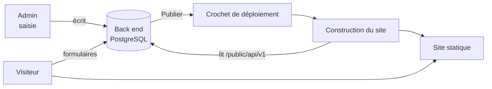

# Liaison site public ↔ admin, dépôt des fichiers et ordre des prompts

## Partie A — Où placer chaque fichier

Il y a **trois projets** (dépôts) : le **back end**, l'**admin**, le **site public**. Chacun reçoit un dossier `docs/`. Les documents de référence sont **copiés dans les trois**, pour que chaque IA les ait sous la main.

```
backend/                    admin/                      site-public/
├─ docs/                    ├─ docs/                    ├─ docs/
│  ├─ 00-LIRE-EN-PREMIER.md │  ├─ (mêmes fichiers)      │  ├─ (mêmes fichiers)
│  ├─ DOCUMENTATION-GUIDE-IA-PRINCE-EDJA.md
│  ├─ SCHEMAS-ENTITES-PRINCE-EDJA.md
│  ├─ ECRANS-ADMIN-PRINCE-EDJA.md
│  ├─ LIAISON-ET-GUIDE-DE-DEPOT-PRINCE-EDJA.md
│  ├─ ADMIN-SIMPLIFIE-PRINCE-EDJA.md
│  ├─ QUESTIONS.md  (créé par l'IA)
│  ├─ RAPPORT-AUDIT-V2-PRINCE-EDJA.md   (site public uniquement)
│  └─ prompts/
│     └─ PROMPT-CORRECTION-PRINCE-EDJA.md
```

| Fichier | back end | admin | site public | Rôle |
|---|:-:|:-:|:-:|---|
| `DOCUMENTATION-GUIDE-IA-PRINCE-EDJA.md` | ✓ | ✓ | ✓ | vocabulaire, architecture, décisions |
| `SCHEMAS-ENTITES-PRINCE-EDJA.md` | ✓ | ✓ | ✓ | forme exacte des données |
| `ECRANS-ADMIN-PRINCE-EDJA.md` | ✓ | ✓ | — | écrans (le back end s'en sert pour les endpoints) |
| `LIAISON-ET-GUIDE-DE-DEPOT-PRINCE-EDJA.md` | ✓ | ✓ | ✓ | ce document |
| `ADMIN-SIMPLIFIE-PRINCE-EDJA.md` | ✓ | ✓ | — | pourquoi 9 entrées |
| `PROMPT-CORRECTION-PRINCE-EDJA.md` | ✓ | ✓ | — | mission de correction (non destructive) |
| `RAPPORT-AUDIT-V2-PRINCE-EDJA.md` | — | — | ✓ | corrections du site public |

**Règle** : les fichiers sont à la **racine de `docs/`** ; le prompt de mission est dans `docs/prompts/`. Ne modifiez pas le contenu sans refaire la copie dans les trois dépôts (sinon les IA divergent). Une seule source : ce dossier de référence.

### Autres fichiers à ne pas oublier
- `.env.example` des trois projets mis à jour (variables Cloudinary, voir documentation §env).
- `docs/QUESTIONS.md` : l'IA y note tout ce qui n'est pas défini (elle n'invente pas).
- Les prompts d'origine (3 fichiers .md livrés au début) restent dans `docs/prompts/archives/` : ils sont **remplacés** par le prompt de correction pour tout ce qui existe déjà.

## Partie B — Quel prompt envoyer, dans quel ordre

Principe : **une IA par dépôt, une étape à la fois, validation avant la suivante**. Chaque message commence par la même phrase d'ancrage :

> « Lis `docs/00-LIRE-EN-PREMIER.md`, puis `docs/DOCUMENTATION-GUIDE-IA-PRINCE-EDJA.md`, `docs/SCHEMAS-ENTITES-PRINCE-EDJA.md` et `docs/ECRANS-ADMIN-PRINCE-EDJA.md`. Tu n'inventes aucun champ, écran ni texte absent de ces documents ; ce qui manque va dans `docs/QUESTIONS.md`. »

| Ordre | Dépôt | Message à envoyer (après la phrase d'ancrage) | Résultat attendu | Vous validez |
|:-:|---|---|---|---|
| 0 | tous | copier les fichiers (Partie A) | dossiers `docs/` en place | vous |
| 1 | back end | « Exécute `docs/prompts/PROMPT-CORRECTION-PRINCE-EDJA.md`, **étape C0 uniquement** (état des lieux, aucun changement de code). » | rapport « attendu / réel » | lecture du rapport |
| 2 | back end | « Étape C1 (Cloudinary). » | stockage Cloudinary, tests verts | tests verts |
| 3 | back end | « Étape D1 (catégories), puis stop. » | catégories par famille | rapport de rapprochement des articles |
| 4 | back end | « Étape D2 (projets et épisodes), puis stop. » | `episode.projet_id`, `projet.categorie_id` | rapport de rapprochement des épisodes |
| 5 | back end | « Étape D3 (livres, variantes, catalogue), puis stop. » | livres, vue catalogue | tests de cloisonnement verts |
| 6 | back end | « Étape D4 (API publique paginée), puis stop. » | `GET /boutique/produits` paginé | appel manuel : 12 par page, `totalPages` correct |
| 7 | back end | « Étape C6 (photos fixes) puis E2 (liaison côté back end). » | `photos-fixes`, `reglages`, objets image | tableau C.3 vérifié |
| 8 | admin | « Étapes C2 à C5, une par une. » | menu à 9 entrées, formulaires, listes | navigation par rôle |
| 9 | admin | « Étape E1 (hub Projets, catégories, livres). Faux serveur autorisé. » | écrans de `ECRANS-ADMIN` | **comparer le hub à votre photo** |
| 10 | admin | « Étape C7 (tableau de bord, mobile), puis branche l'admin sur le vrai back end (désactive MSW). » | admin réel | parcours de test (Partie D, étapes 1 à 8) |
| 11 | site public | « Applique la section 9 de `RAPPORT-AUDIT-V2` (modale newsletter et corrections), puis ajoute la pagination de la boutique (SCHEMAS §12.2) et l'onglet Livres. Garde les données mock. » | site corrigé | revue visuelle |
| 12 | site public | « Branche le site sur l'API selon la Partie C de `LIAISON` (script de chargement, formulaires). » | site alimenté par l'admin | Partie D complète |
| 13 | back end + admin | « Étape C9 (nettoyage), un élément à la fois. » | — | **uniquement sur votre confirmation écrite** |

Ne lancez jamais deux étapes dans le même message. Si l'IA propose de « tout refaire », répondez : « Non, suis la mission, étape suivante seulement. »

## Partie C — La liaison site public ↔ admin

### C.1 Principe


- L'admin **n'écrit jamais** dans le site. Il écrit dans le back end.
- Le site est **reconstruit** après chaque publication : la page lit l'API **au moment de la construction** et produit des fichiers statiques.
- Seuls les **formulaires** (contact, collaboration, abonnement, demande de pièce) appellent le back end **depuis le navigateur**.
- Une modification n'est visible qu'après une publication (« Technique → Publication »). Une programmation déclenche une publication à l'heure prévue.

### C.2 Script de chargement (site public)
Fichier à créer : `scripts/charger-donnees.ts`, exécuté avant la construction (`npm run charger` puis `npm run build`).
Pour chaque type : appelle l'API (toutes les pages), valide avec Zod, écrit un JSON dans `src/data/generated/`. Le site importe ces JSON **à la place** des fichiers mock. Les anciens fichiers mock restent comme **secours en développement** (variable `PUBLIC_DATA_SOURCE=mock|api`).
Variables : `PUBLIC_API_URL`, `PUBLIC_LANGUES`. Échec d'un appel = **la construction échoue** (jamais de site à moitié vide).

### C.3 Table de correspondance
| Données du site (fichier actuel) | Endpoint public | Écran admin qui l'alimente |
|---|---|---|
| `data/content.ts` — articles du Journal | `GET /contenus/articles` | Journal |
| `data/content.ts` — `CATEGORIES_JOURNAL` | `GET /categories?famille=article` | Boutique → Catégories (section Articles) |
| `data/projets.ts` — projets | `GET /contenus/projets` | Projets → listes de projets |
| (catégories de projets) | `GET /categories?famille=projet` | Catégories (section Projets) |
| épisodes | `GET /contenus/episodes` (avec `projetSlug`) | Projets → Épisodes |
| destinations, guides | `GET /contenus/destinations` | Projets → Destinations / Guides PDF |
| villes Taste & Travel | `GET /contenus/villes` | Projets → Villes |
| archive | `GET /contenus/archive` | Projets → Archive |
| `data/shop.ts` — `PIECES` | `GET /boutique/produits` (paginé) + détail | Boutique → Bijoux |
| `data/livres.ts` — `LIVRES_MOCK` | idem, `type=livre` | Boutique → Livres |
| `data/shop.ts` — `CATEGORIES_SHOP` | `GET /categories?famille=produit` | Catégories (section Produits) |
| créateurs | `GET /contenus/createurs` | Boutique → Créateurs |
| galeries accueil et boutique | `GET /galeries/:emplacement` | Médiathèque → Sur le site |
| photos fixes (héros, portraits…) | `GET /photos-fixes` | Médiathèque → Sur le site |
| audience, distinctions, presse, partenaires | `GET /contenus/<type>` | Preuves et presse |
| pages légales | `GET /contenus/pages-legales` | Réglages → Pages légales |
| identité, langues, boutique en ligne | `GET /reglages` | Réglages → Identité et paramètres |
| étiquettes | `GET /etiquettes` | Réglages → Étiquettes |
| formulaire contact / collaboration | `POST /messages` | Boîte de réception → Messages |
| formulaire abonnement | `POST /abonnes` puis lien de confirmation | Boîte de réception → Abonnés |
| formulaire demande de pièce | `POST /demandes` | Boîte de réception → Demandes |

(Les routes `contenus/:type` existent déjà ; l'IA vérifie le nom exact de chaque route dans `modules/` et corrige ce tableau si besoin — **elle ne crée pas de route dont l'équivalent existe**.)

### C.4 Images
Le back end renvoie des **objets image** `{ url, alt, largeur, hauteur, declinaisons[] }` (adresse complète construite avec `MEDIA_PUBLIC_BASE_URL` / Cloudinary). Le site affiche avec `srcset` à partir des déclinaisons et le texte alternatif. **Aucune adresse Cloudinary n'est écrite en dur dans le site.**

### C.5 Pagination de la boutique
Voir SCHEMAS §12.2 : phase 1 (tout charger, paginer dans le navigateur) puis phase 2 (appel API) sans changer le back end.

### C.6 Contrats à ne pas casser
1. Le site ne dépend d'**aucun champ** absent de SCHEMAS.
2. Tout changement de réponse d'API = **mise à jour du schéma Zod partagé** des deux côtés le même jour.
3. Les adresses (slugs) publiées ne changent pas ; si un titre change, l'adresse reste.
4. Un contenu `brouillon`, `en_relecture` ou programmé dans le futur **n'apparaît jamais** dans l'API publique.

## Partie D — Parcours de test de la liaison (à faire vous-même)
1. Dans l'admin, créer une catégorie d'article « Test », un article dans cette catégorie, l'image principale avec texte alternatif ; **Publier**.
2. Technique → Publication : attendre « réussie ».
3. Ouvrir le site : l'article apparaît dans le Journal, filtre « Test » actif, image et texte alternatif corrects.
4. Créer un projet (format Série), deux épisodes rattachés ; publier ; vérifier la page du projet et l'ordre des épisodes.
5. Créer un bijou et un livre dans deux catégories ; publier ; vérifier la boutique, le filtre par type, la **pagination** (créer 13 produits pour voir 2 pages).
6. Changer la photo « accueil — héros » dans Médiathèque → Sur le site ; publier ; vérifier l'accueil.
7. Envoyer un message de contact depuis le site ; le retrouver dans la Boîte de réception.
8. S'abonner depuis la modale ; confirmer par e-mail ; voir l'abonné « actif ».
9. Programmer un article dans 5 minutes ; vérifier qu'il apparaît seul à l'heure dite.
10. Dépublier l'article ; republier ; vérifier qu'il disparaît du site.
