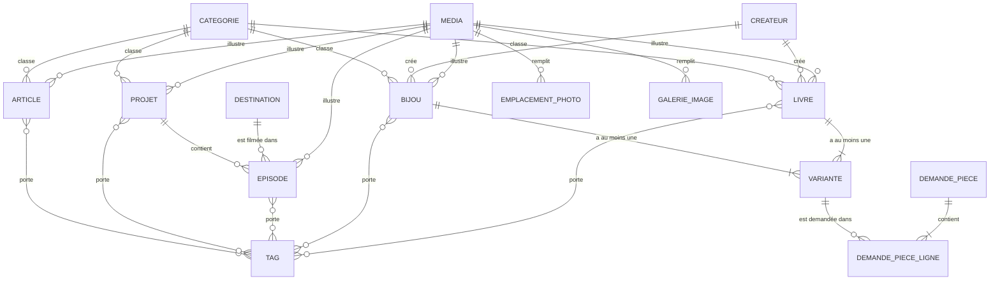
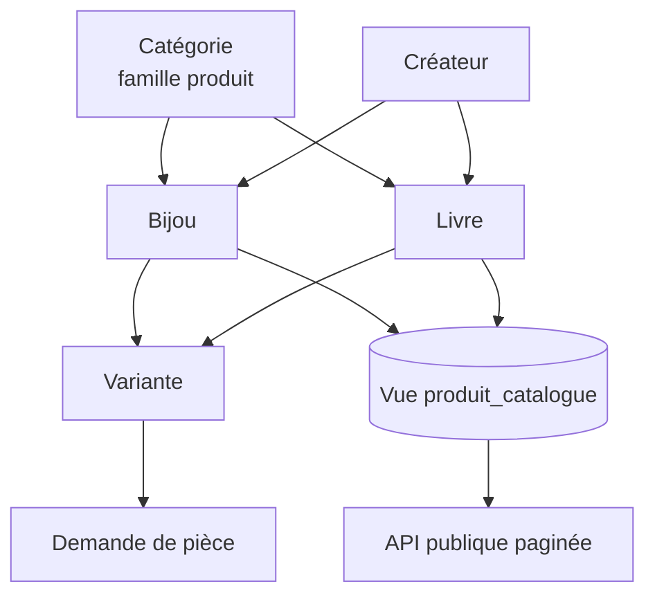

# Schémas des entités — Prince EDJA

Ce document fixe la **forme exacte** de chaque entité : champs, types, règles, relations, catégories, produits (bijoux et livres) et pagination. Il part du code existant (`db/schema/*.ts`) et marque clairement ce qui est **existant**, ce qui est **nouveau**, et ce qui est **modifié**. L'IA n'invente aucun champ qui n'est pas ici ; si un champ manque, elle le note dans `docs/QUESTIONS.md`.

**Légende** : `existant` = déjà dans le code · `NOUVEAU` = à ajouter par migration · `MODIFIÉ` = existe, change de forme (toujours de façon additive : on ne supprime pas de colonne dans cette mission).

## 1. Conventions communes

| Convention | Règle |
|---|---|
| Identifiants | `uuid`, générés par la base |
| Contenu à cycle de vie | colonnes communes (`colonnesContenu`) : `id`, `statut` (`brouillon`, `en_relecture`, `publie`), `publie_le`, `auteur_id`, `cree_le`, `modifie_le`, `version`, `dernier_motif_refus` |
| Programmé | `statut = publie` et `publie_le` dans le futur. Les lectures publiques filtrent `publie_le <= maintenant` |
| Langues | `fr`, `en`. Les textes vivent dans une table `<entité>_traduction` (clé : identifiant + langue) |
| Adresse (slug) | dans la table de traduction ; unique par langue (RG-04) |
| Version | entier incrémenté à chaque modification ; conflit → 409 `VERSION_PERIMEE` |
| Image | toujours une référence à `media(id)` avec `on delete restrict` ; le texte alternatif est sur le média |
| Texte riche | JSON produit par TipTap, vérifié par une liste blanche (`shared/corps-riche.ts`) |
| Ordre | colonne `ordre` entière pour les listes réordonnables |
| « À compléter » | un champ requis encore vide. **Calculé**, ce n'est pas un statut |

## 2. Vue d'ensemble



**Deux systèmes de classement, à ne pas confondre**

| | Catégorie | Étiquette (tag) |
|---|---|---|
| Combien par contenu | **une seule** | plusieurs |
| Rôle | le **grand classement** affiché dans les menus et les filtres (« Voyage », « Mode ») | un classement **fin et transversal** (pays, ville, thème, année, format, projet) |
| Gérée dans | Réglages → catégories de chaque section | Réglages → Étiquettes |

## 3. Catégories (articles, projets, produits)

### 3.1 Principe

Un seul mécanisme pour les trois familles. La table `categorie` existe déjà (elle sert aux bijoux). On y ajoute une **famille**.

| Famille | S'applique à | Valeurs de départ (amorçage) | Obligatoire à la publication |
|---|---|---|---|
| `article` | articles du Journal | **8, imposées par le cahier des charges** : Voyage, Histoire, Patrimoine, Tourisme, Hospitalité, Opinion, Portraits, Carnets de route | oui |
| `projet` | projets (Histoires) | **aucune** : le cahier des charges n'en fournit pas (voir question Q1) | non |
| `produit` | bijoux **et** livres | **8, imposées par le cahier des charges** : Bijoux & accessoires, Mode, Livres & photographie, Art & décoration, Travel essentials, Éditions X'PLORE, Guides, Collections limitées | oui |

### 3.2 Table `categorie` (MODIFIÉ)

| Colonne | Type | État | Notes |
|---|---|---|---|
| `id` | uuid | existant | |
| `famille` | enum `famille_categorie` (`article`, `projet`, `produit`) | **NOUVEAU** | défaut `produit`, ce qui garde les catégories existantes valides |
| `ordre` | entier | existant | |
| `visible` | booléen | existant | défaut vrai |
| `version` | entier | existant | |

Table `categorie_traduction` : `categorie_id`, `langue`, `slug`, `nom` (existant). **Contrainte d'unicité modifiée** : le slug doit être unique par **famille et langue** (aujourd'hui par langue seulement). Implémentation : colonne `famille` dupliquée sur la traduction, tenue cohérente par clé étrangère composite `(categorie_id, famille)`, et contrainte `unique (famille, slug, langue)`.

### 3.3 Règles

- **RG-29** : une catégorie appartient à une famille ; un contenu ne reçoit qu'une catégorie de **sa** famille. Erreur `CATEGORIE_INCOMPATIBLE` (422).
- **RG-30** : un article publié et un produit publié (bijou ou livre) ont une catégorie. Un projet n'en a pas obligatoirement.
- **RG-31** : une catégorie sans contenu publié est masquée côté public (extension de RG-09). Une catégorie utilisée ne peut pas être supprimée (409 `CATEGORIE_UTILISEE`, avec le nombre d'éléments concernés). On peut la masquer (`visible = faux`).
- **RG-31 bis** : renommer une catégorie ne change pas son slug tant qu'elle a du contenu publié (liens stables).

### 3.4 Migration des catégories existantes

1. Ajouter `famille` (défaut `produit`) à `categorie` et à `categorie_traduction` ; migrer la contrainte d'unicité.
2. Semer les 8 catégories `article` et vérifier/semer les 8 catégories `produit` (sans doublon avec l'existant : rapprocher par slug).
3. **Articles** : ajouter `article.categorie_id` (nullable). Rapprocher le texte libre `article.categorie` des catégories `article` (comparaison insensible à la casse et aux accents) ; tout article sans correspondance reste à `NULL` et apparaît en « À compléter ». **La colonne texte `article.categorie` est conservée** (jusqu'à l'étape de nettoyage C9).
4. **Projets** : ajouter `projet.categorie_id` (nullable).
5. Écrire la descente (`bas.sql`) de chaque migration.

## 4. Articles (Journal)

Table `article` (existant) — **une seule modification** : `categorie_id`.

| Champ | Type | Requis pour publier | Notes |
|---|---|---|---|
| (colonnes communes) | | | voir 1 |
| `categorie_id` | uuid → `categorie`, famille `article` | **oui** (RG-30) | **NOUVEAU** |
| `categorie` | texte | non | existant, **déprécié**, conservé |
| `image_id` | uuid → `media` | oui | image principale, texte alternatif obligatoire (RG-08) |
| `a_la_une` | booléen | non | un article « à la une » à la fois côté accueil, géré par le service |
| `duree_lecture` | entier > 0 (minutes) | non | calculable depuis le texte |

Table `article_traduction` (existant) : `article_id`, `langue`, `slug`, `titre`, `extrait` (défaut vide), `corps` (JSON TipTap), `seo_titre`, `seo_description`.

**Étiquettes** (`article_tag`) : un **format** est exigé (RG-06) ; `pays`, `ville`, `theme`, `annee`, `projet` sont facultatifs.

**Articles liés** : calculés, jamais saisis. Deux articles sont liés s'ils partagent au moins une étiquette de type `pays`, `theme` ou `projet` (RG-07).

**Pour publier** (RG-03) : titre, adresse, extrait, image avec texte alternatif, **catégorie**, étiquette de format, dans chaque langue active.

## 5. Projets

Table `projet` (existant).

| Champ | Type | Requis pour publier | Notes |
|---|---|---|---|
| (colonnes communes) | | | |
| `format` | enum : `Documentaire`, `Série`, `Émission`, `Archive` | oui | **détermine le modèle de page publique** (voir 5.1) |
| `avancement` | enum : `disponible`, `en_production`, `en_preparation` | oui | |
| `annee` | texte | non | |
| `image_id` | uuid → `media` | oui | l'**affiche** |
| `categorie_id` | uuid → `categorie`, famille `projet` | non | **NOUVEAU** |
| `cible` | JSON | non | lien interne (contrat § 6) quand la page du projet n'est pas la page standard |
| `ordre` | entier | non | |

Table `projet_traduction` (existant) : `slug`, `titre`, `accroche`. **NOUVEAU** : `contenu` (JSON TipTap, nullable) pour la présentation longue du projet.

### 5.1 Format et modèle (template)

Le « modèle de rendu » n'est **pas un champ saisi** : il se déduit du format. Le tableau est la source de vérité de l'écran « Moteur de rendu public ».

| Format | Libellé du modèle | Sous-titre affiché | Usage |
|---|---|---|---|
| `Série` | Template Série | X'PLORE | séries (X'PLORE, Taste & Travel) |
| `Documentaire` | Template Documentaire | Production indépendante | films documentaires |
| `Émission` | Template Émission | Programme | émissions |
| `Archive` | Template Archive | Patrimoine audiovisuel | projets d'archives |
| (épisodes) | Template unique d'épisode | Utilisé par tous les projets | tous les épisodes |

L'admin n'édite pas ces modèles : elle les **montre** et permet de **créer un projet dans un format donné**. Le code du site public contient les mises en page.

## 6. Épisodes

Table `episode` (existant).

| Champ | Type | Requis pour publier | Notes |
|---|---|---|---|
| (colonnes communes) | | | |
| `projet_id` | uuid → `projet`, `on delete restrict` | non | **NOUVEAU** (aujourd'hui l'épisode n'est relié à aucun projet) |
| `numero` | texte unique | oui | ex. `E01` ; sert à l'ordre dans le projet |
| `image_id` | uuid → `media` | oui | l'affiche |
| `guide_media_id` | uuid → `media` (PDF) | non | guide téléchargeable |
| `destination_id` | uuid → `destination`, `on delete set null` | non | |
| `trailer_url` | texte | non | lien de la bande-annonce |
| `duree_minutes` | entier > 0 | non | |

Table `episode_traduction` (existant) : `slug`, `titre`, `lieu`, `pitch`, `synopsis_long`, `note_intention`, `personnages`, `making_of`, `presse`, `credits`.

**Rattachement** (RG-32) : un épisode appartient à zéro ou un projet ; dans un projet, l'ordre suit `numero`. **Migration** : relier les épisodes existants aux projets d'après leur étiquette de type `projet` quand la correspondance est sûre (ex. étiquette X'PLORE → projet du format Série X'PLORE) ; sinon laisser `NULL`. Vérifier en C0 qu'aucune colonne équivalente n'existe déjà.

## 7. Destinations, villes, guides PDF

**`destination`** (existant) : colonnes communes ; `latitude`, `longitude` (requis pour publier, bornes -90/90 et -180/180) ; `episode_id` → `episode` (set null) ; `guide_media_id` → `media` (PDF) ; `image_id` → `media`. Traduction : `slug`, `nom`, `texte`.
Règle existante : pour une destination en Côte d'Ivoire, les coordonnées doivent tomber dans les limites du pays (`COORDONNEES_HORS_PAYS`).

**`ville_taste`** (existant) : colonnes communes ; `image_id` ; `ordre`. Traduction : `nom`, `intention`.

**Guides PDF** : pas de table. Un guide est un **média PDF** rattaché via `guide_media_id` à une destination ou un épisode. Le service refuse un fichier qui n'est pas un PDF.

## 8. Produits : bijoux et livres

### 8.1 Principe

Deux types de produits, une même boutique, des catégories communes (famille `produit`), des variantes communes.



### 8.2 Bijou (`bijou`, existant, **inchangé**)

| Champ | Type | Notes |
|---|---|---|
| (colonnes communes) | | |
| `numero` | texte unique | numéro dans la collection |
| `createur_id` | uuid → `createur` | requis (RG-20) |
| `categorie_id` | uuid → `categorie`, famille `produit` | requis ; **contrôlé** par RG-29 |
| `image_id` | uuid → `media` | image principale |
| `visible` | booléen | masque sans dépublier |
| `prix_confirme` | booléen | le prix ne s'affiche que s'il est vrai ; sinon « sur demande » |
| `edition_numero`, `edition_total` | entiers | édition limitée, `1 ≤ numéro ≤ total` |
| `atelier`, `village` | texte | |
| `poids_grammes` | décimal > 0 | |

Traduction : `slug`, `nom`, `culture` (origine du symbole, **pas** la catégorie), `histoire`. Galerie : `bijou_media` (5 à 8 photos, `ordre`). Étiquettes : `bijou_tag`.

### 8.3 Livre (`livre`, **NOUVEAU**)

| Champ | Type | Requis pour publier | Notes |
|---|---|---|---|
| (colonnes communes) | | | |
| `reference` | texte unique | oui | numéro interne (ex. `L01`) |
| `createur_id` | uuid → `createur` | oui | pour le multi-vendeurs et le cloisonnement (équivalent de RG-20) |
| `categorie_id` | uuid → `categorie`, famille `produit` | oui | RG-29, RG-30 |
| `image_id` | uuid → `media` | oui | la couverture |
| `visible` | booléen | non | défaut vrai |
| `prix_confirme` | booléen | non | même règle que le bijou |
| `auteur` | texte | non | nom affiché de l'auteur (peut différer du créateur) |
| `editeur` | texte | non | |
| `isbn` | texte | non | |
| `annee_publication` | entier | non | |
| `nombre_pages` | entier > 0 | non | |

Traduction `livre_traduction` : `slug`, `titre`, `resume`. Galerie : `livre_media` (couverture, quatrième de couverture, pages intérieures ; mêmes règles que `bijou_media`). Étiquettes : `livre_tag`.

Sécurité : mêmes règles de sécurité par ligne que `bijou` (un vendeur ne voit que ses livres).

### 8.4 Variante (`variante`, **MODIFIÉ**)

Une variante est l'unité demandée ou vendue. Elle appartient à **exactement un** produit.

| Champ | Type | État | Notes |
|---|---|---|---|
| `id` | uuid | existant | |
| `bijou_id` | uuid → `bijou` | **MODIFIÉ** : devient nullable | |
| `livre_id` | uuid → `livre` | **NOUVEAU** | |
| `reference` | texte unique | existant | pour un livre : ISBN ou référence interne |
| `libelle` | texte | **NOUVEAU** | nom court de la variante (ex. « Broché », « Relié ») |
| `matiere`, `taille` | texte | existant | utilisés par les bijoux |
| `prix` | décimal ≥ 0 | existant | vide = non communiqué, **jamais 0 par défaut** |
| `ancien_prix` | décimal | existant | doit être supérieur au prix |
| `stock` | entier ≥ 0 | existant | vide = non suivi |
| `disponible` | booléen | existant | |
| `ordre`, `version` | entiers | existant | |

**Contrainte** (RG-33) : `(bijou_id IS NOT NULL) <> (livre_id IS NOT NULL)` — exactement l'un des deux. Tout produit a au moins une variante (RG-10, contrôlé par le service). Le prix et le stock ne s'affichent que si `boutiqueEnLigne` est vrai (RG-10).

`demande_piece_ligne` reste inchangée : elle référence une variante, donc fonctionne pour les deux types (RG-11 : une demande cite une variante et ne réserve aucun stock).

### 8.5 Vue du catalogue (`produit_catalogue`, **NOUVEAU**)

Vue SQL en lecture seule qui rassemble bijoux et livres. Elle permet de lister, filtrer et **paginer** les deux types ensemble.

| Colonne | Source |
|---|---|
| `type` | `'bijou'` ou `'livre'` |
| `id`, `statut`, `publie_le`, `visible`, `createur_id`, `categorie_id`, `image_id`, `prix_confirme` | colonnes du produit |
| `reference` | `numero` (bijou) ou `reference` (livre) |
| `prix_min` | plus petit prix des variantes disponibles et non nul |
| `disponible` | vrai si au moins une variante disponible |

La vue ne contient que les produits publiés dont `publie_le <= maintenant` quand elle est utilisée par l'API publique. La traduction (nom, slug) est jointe au moment de la lecture, pour la langue demandée.

### 8.6 Règles de gestion des produits

| Règle | Contenu |
|---|---|
| RG-10 | un produit a au moins une variante ; prix et stock sur la variante ; visibles seulement si `boutiqueEnLigne` |
| RG-11 | une demande de pièce cite une variante et ne réserve aucun stock |
| RG-20 | tout produit a un créateur |
| RG-29, RG-30 | catégorie de la bonne famille, obligatoire à la publication |
| RG-33 | une variante appartient à un seul produit (bijou ou livre) |

## 9. Créateurs (`createur`, existant)

`slug` unique, `nom`, `pays`, `ville`, `photo_media_id`, `statut`, `publie_le`, `actif`, `est_principal` (un seul créateur principal, RG-21), `taux_commission` (vide = non défini, jamais inventé), `premiere_publication_le` (non vide = slug figé), colonnes de version. Traduction : `bio`, `accroche`.

Le créateur existe **toujours**, même sans multi-vendeurs : Prince est le créateur principal. Les comptes `vendeur` liés à un créateur n'existent que si `multiVendeurs` est vrai.

## 10. Médias et emplacements

**`media`** (existant) : `createur_id` (cloisonnement), `cle_stockage` unique (la **clé**, jamais l'adresse complète), `mime`, `largeur`, `hauteur`, `poids`, `credit`, `decoratif` (texte alternatif vide autorisé), `supprime_le` (suppression différée 24 h), `version`. Traduction : `texte_alt` (exigé à la publication, RG-08), `legende`. Déclinaisons : `media_declinaison` (`largeur`, `cle_stockage`).

**`galerie_image`** (existant) : colonnes communes ; `emplacement` (`accueil` ou `boutique`) ; `media_id` ; `cible` (lien interne) ; `lien_externe` ; `ratio` ; `parallaxe` ; `ordre`. Traduction : `etiquette`, `titre`, `legende`.

**`emplacement_photo`** (**NOUVEAU**) : `cle` (clé primaire, ex. `accueil.heros`), `libelle`, `format_conseille`, `media_id` (nullable, `restrict`), `mis_a_jour_le`, `mis_a_jour_par`. Créée et semée par l'amorçage ; on ne crée ni ne supprime d'emplacement depuis l'admin.

## 11. Autres entités (existantes, résumé)

| Entité | Champs principaux | Notes |
|---|---|---|
| `distinction` | nature (`distinction` ou `fonction_officielle`), année, organisme, lien, image ; traduction : titre, description | année requise à la publication |
| `parution_presse` | source, date de publication, lien, avatar, à la une ; traduction : titre, résumé, citation | une seule parution « à la une » à la fois |
| `partenaire` | logo, lien, ordre ; traduction : nom | |
| `audience_ligne` | plateforme, taille, portée, **date de validation**, source, ordre | le CDC exige des chiffres datés |
| `archive_entree` (+ sources) | fiabilité (`documentee`, `memoire_orale`, `interpretation`), sources typées | une entrée sans source n'est pas publiable |
| `page_legale` | clé (`mentions-legales`, `confidentialite`, `cookies`, `cgv`, `retours`) ; traduction : titre, résumé, corps | |
| `message_contact` | type (`contact`, `collaboration`), nom, e-mail, motif, message, **entreprise, pays, type de collaboration, calendrier, budget**, statut (`non_lu`, `lu`, `traite`, `archive`), note interne, date de purge | les champs du formulaire B2B existent déjà côté back end |
| `abonne` | e-mail unique, prénom, pays, langue, statut (`en_attente`, `actif`, `desabonne`), confirmation | actif seulement après confirmation (RG-12) |
| `consentement` | finalité, texte exact, version, source (page d'origine), date, empreinte d'IP | RG-13 |
| `demande_piece` (+ lignes) | nom, e-mail, message, langue, statut (`nouvelle`, `en_cours`, `conclue`), note interne | RG-11 |
| `tag`, `tag_type` | types : `pays`, `ville`, `theme`, `annee`, `format`, `projet` ; traduction : libellé | |
| `document_reglage` | clé `parametres` : `boutiqueEnLigne`, `multiVendeurs`, `languesActives`, durées de conservation, regroupement de publication | |

## 12. Pagination

### 12.1 Admin (existant, inchangé)

Toutes les listes de l'admin : `page` (≥ 1, défaut 1) et `pageSize` (1 à 100, défaut 20) ; tri `champ` ou `-champ` ; réponse `{ items, page, pageSize, total }`. L'écran affiche : « 21–40 sur 132 », boutons Précédent et Suivant, choix de 20, 50 ou 100 par page, et **conserve les filtres dans l'adresse**.

### 12.2 Boutique publique (NOUVEAU)

**Comportement attendu sur la page Boutique**

| Élément | Règle |
|---|---|
| Taille de page | **12 produits** par page (cartes), 24 si l'écran est large (≥ 1536 px) ; jamais plus de 48 |
| Adresse | `/boutique?type=bijou|livre&categorie=<slug>&tri=<tri>&page=<n>` ; la page 1 n'affiche pas `page=1` |
| Filtres | type (bijou, livre), catégorie, disponibilité, créateur ; **tout changement de filtre revient à la page 1** |
| Tri | `nouveautes` (par défaut, `publie_le` décroissant), `nom` (A→Z), `prix-croissant`, `prix-decroissant` (les produits « sur demande » sont **toujours en dernier**) |
| Composant | « Précédent », numéros avec fenêtre (1 … 4 5 **6** 7 8 … 20), « Suivant » ; `nav` avec `aria-label="Pagination"`, page courante avec `aria-current="page"`, cibles de 44 px |
| Changement de page | retour en haut de la grille, focus sur le titre de la liste, annonce vocale « Page 3 sur 8 » |
| Page hors limite | redirection vers la dernière page |
| Aucun résultat | message clair + bouton « Effacer les filtres » |
| Compteur | « 36 produits » et « Page 2 sur 3 » |
| Référencement | chaque page a son adresse ; la page 2 et suivantes ont leur propre `canonical` |

**API publique** (lecture)

`GET /public/api/v1/boutique/produits?langue=fr&type=&categorie=&createur=&disponible=&q=&tri=&page=1&pageSize=12`

Réponse :

```json
{
  "items": [ { "type": "bijou", "slug": "…", "nom": "…", "reference": "…",
               "image": { "url": "…", "alt": "…", "declinaisons": [ { "largeur": 480, "url": "…" } ] },
               "categorie": { "slug": "…", "nom": "…" },
               "createur": { "slug": "…", "nom": "…" },
               "prixAffiche": null, "prixConfirme": false, "ancienPrix": null,
               "disponible": true } ],
  "page": 1, "pageSize": 12, "total": 36, "totalPages": 3,
  "categories": [ { "slug": "…", "nom": "…", "compte": 14 } ]
}
```

`prixAffiche` est `null` quand le prix n'est pas confirmé ou quand `boutiqueEnLigne` est faux (le site affiche alors « sur demande »). `categories` renvoie les catégories **non vides**, avec leur effectif, pour construire les filtres (RG-31).

`GET /public/api/v1/boutique/produits/:slug?langue=fr` : fiche complète (histoire, galerie, variantes, créateur).

### 12.3 Où se fait la pagination, à la construction ou au chargement ?

Le site public est construit à partir de l'API.

- **Phase 1 (par défaut)** : à la construction, le site récupère **tout** le catalogue en JSON, et la pagination, le tri et les filtres se font dans le navigateur (adresse de la page conservée). C'est suffisant jusqu'à environ 300 produits.
- **Phase 2 (si le catalogue dépasse ~300 produits)** : la page appelle l'API publique paginée pendant la navigation.
- **L'API est paginée dès maintenant**, pour que le passage à la phase 2 ne demande aucune modification du back end.

## 13. Règles de gestion ajoutées

| Règle | Contenu |
|---|---|
| RG-29 | un contenu ne reçoit qu'une catégorie de sa famille (`CATEGORIE_INCOMPATIBLE`) |
| RG-30 | article et produit publiés : catégorie obligatoire ; projet : facultative |
| RG-31 | catégorie vide masquée côté public ; catégorie utilisée non supprimable ; renommer ne change pas le slug d'un contenu publié |
| RG-32 | un épisode appartient à zéro ou un projet ; l'ordre suit `numero` |
| RG-33 | une variante appartient à exactement un produit, bijou ou livre |
| RG-34 | toute liste publique est paginée ; une page ne dépasse jamais 48 éléments ; le tri est stable (départage par identifiant) |

## 14. Questions à trancher

| # | Question | Par défaut en attendant |
|---|---|---|
| Q1 | Quelles catégories de **projets** (ex. Voyage, Gastronomie, Patrimoine…) ? Le cahier des charges n'en donne pas. | aucune ; le format sert de classement |
| Q2 | Champs d'un **livre** : `auteur`, `éditeur`, `isbn`, `année`, `pages` suffisent-ils ? | ceux listés en 8.3 |
| Q3 | Un livre a-t-il plusieurs variantes (broché, relié, numérique) ? | oui, la structure le permet ; une seule variante suffit |
| Q4 | Catégories d'articles : les 8 du cahier des charges, sans ajout par le client ? | le client peut en ajouter dans Réglages |
| Q5 | Les « Guides » (catégorie de la boutique) sont-ils des produits vendus, ou les guides PDF des destinations ? | produits vendus ; les guides PDF de destination restent des fichiers à télécharger |
